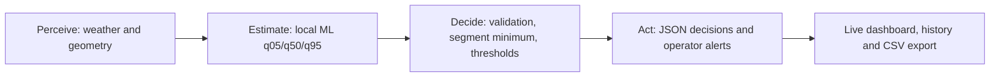

# GridPilot AI

**A decision-support agent for the dynamic capacity of a simulated overhead power line in Dobrogea, Romania.**

Built for **24h to Power PPC – AI in energy, from data to action**. The target domain is grid operation, relevant to **Rețele Electrice**, with potential benefits for producers such as **PPC Renewables** when electricity delivery is constrained by conductor thermal capacity.

GridPilot retrieves weather data, runs a locally trained ML model, identifies the limiting segment, and publishes operator recommendations and alerts. It includes a dashboard, automatically refreshed forecasts, historical data exploration, and CSV/JSON exports.

> **Simulation prototype, not a grid control system.** We do not use PPC telemetry, connect to SCADA, or control generators or circuit breakers. Estimated capacity in amperes is not measured current. P1–P3 on the map are illustrative sites; their power injections are not modeled.

## 1. Problem and solution

A static rating is based on reference weather conditions. Actual conductor cooling varies with wind, air temperature, and solar radiation. GridPilot estimates hourly capacity and indicates when conditions suggest additional capacity or require human review.

The line is simplified into three segments in series. Its overall rating is the minimum segment rating at the same hour. Additional capacity does not automatically mean additional energy delivered: available generation and other grid constraints must also be considered.



| Stage | Implementation | Evidence |
|---|---|---|
| Perceive | Historical/public data, forecasts, UTC, units, and quality checks | [data_pipeline.py](gridpilot-ai/src/data_pipeline.py) |
| Estimate | Locally trained HGB using physics-generated labels; three ampacity quantiles | [ml_model.py](gridpilot-ai/src/ml_model.py), [physics_engine.py](gridpilot-ai/src/physics_engine.py) |
| Decide | Validation, limiting segment, uncertainty, and risk classification | [agent.py](gridpilot-ai/src/agent.py), [decision_engine.py](gridpilot-ai/src/decision_engine.py) |
| Act | Automatic decision export, notifications, and a human-review queue | [live_pipeline.py](gridpilot-ai/src/live_pipeline.py), [alert_service.py](gridpilot-ai/src/alert_service.py), [Alerts](gridpilot-ai/pages/alerts.py) |

The agent is a deterministic workflow using ML predictions; it does not depend on an LLM or an external inference API. Its autonomous actions are decision publication, in-app alerting, and archiving. Applying a rating to an operational grid remains the operator's responsibility.

## 2. Reproducible setup

Verified environment: **Python 3.11**, scikit-learn **1.6.1**, NumPy **2.4.6**, pandas **2.2.3**, joblib **1.6.0**, Streamlit **1.67.0**, and LineRate **5.0.0**. The default model is `models/ampacity_model.joblib`; the scikit-learn version should match the saved artifact.

In PowerShell, from the directory where you want to clone the project:

```powershell
git clone https://github.com/Fandrei19/Smarthack.git
cd Smarthack/gridpilot-ai
py -3.11 -m venv .venv
.venv/Scripts/python.exe -m pip install --upgrade pip
.venv/Scripts/python.exe -m pip install "numpy==2.4.6" "pandas==2.2.3" "scikit-learn==1.6.1" "joblib==1.6.0" "streamlit==1.67.0" "linerate==5.0.0" pytest matplotlib
```

The existing `requirements.txt` contains only NumPy and pandas; **it is not sufficient for the complete application**. The command above also installs ML, UI, physics, and testing dependencies. On Linux/macOS, use `python3.11 -m venv .venv` and `.venv/bin/python` instead of the Windows executable.

Run all subsequent commands from `gridpilot-ai` with the environment activated. In PowerShell, replace `python` with `.venv/Scripts/python.exe` if environment activation is restricted.

```powershell
.venv/Scripts/Activate.ps1
python -m streamlit run app.py
```

Application: **http://localhost:8501**. Opening it retrieves a forecast and runs the model and agent. An internet connection is required for the API and map background.

### Offline model and agent demo

```bash
python -B -m src.ml_model predict --weather data/demo/weather_mock.csv --out data/processed/predictions_demo.csv
python -B -m src.agent --predictions data/processed/predictions_demo.csv --output data/processed/agent_results_demo.json
```

The synthetic input contains 24 hours × 3 segments: **72 predictions and 24 line decisions**. This CLI workflow runs without API access after installation. The dashboard uses live files and does not automatically switch to demo data; synthetic data is not presented as a current forecast.

### One-time live refresh

```bash
python -B -m src.live_pipeline --once
```

This generates `weather_live.csv`, `predictions_live.csv`, and `agent_results_live.json` in `data/processed/`. The dashboard refreshes on first opening and approximately every 15 minutes while a session is active; **Refresh now** triggers an immediate update. The dashboard does not start a permanent background service. Running the CLI without `--once` is a separate continuous mode that runs until stopped.

## 3. Operator interface

- **Overview:** estimated rating, static reference, limiting segment, and agent recommendation.
- **Line Monitoring:** hour selection, per-segment capacity, weather, q05–q95 intervals, and CSV export.
- **Map:** three illustrative locations in Dobrogea; P1–P3 are site markers, while SEG_1–SEG_3 are conductor segments. No generation or SCADA power injection is calculated.
- **Alerts:** reason, hour, segment, priority, and acknowledgement. Includes in-app notifications and CSV export.
- **Weather History:** dataset, date range, segment, and weather-variable selection, with charts and filtered downloads.

Notifications are in-app, not email, SMS, or push notifications outside the application. Alerts are checked every minute while the session is active. **Acknowledge** is stored in the browser session; it neither resolves the underlying condition nor approves the rating.

History explicitly separates historical weather from saved forecasts. Every successful live run is archived in `data/archive/<UTC run ID>/`, including weather, predictions, decisions, and retrieval time. Archives are local, ignored by Git, and do not yet have an automatic retention policy. Archived forecasts do not become actual observations after their valid time has passed.

## 4. Data, sources, and contracts

| Source | Usage | Reference |
|---|---|---|
| ERA5 through Open-Meteo | Historical weather for 2022–2025 used by the current model | [Historical Weather API](https://open-meteo.com/en/docs/historical-weather-api) |
| NASA POWER | Alternative historical export; example verified for July 15–21, 2025 | [Hourly API](https://power.larc.nasa.gov/docs/services/api/temporal/hourly/) |
| Open-Meteo Forecast | Next 24 hours in the live workflow | [Forecast API](https://open-meteo.com/en/docs) |
| Synthetic data | Offline demo, identified in the `source` field | [weather_mock.csv](gridpilot-ai/data/demo/weather_mock.csv) |
| LineRate / CIGRE601 | Physics-generated training labels | [Official example](https://statnett.github.io/linerate/auto_examples/plot_cigre.html) |

Weather data consists of gridded estimates and forecasts, not conductor-mounted sensor measurements. NASA parameters are `T2M`, `WS10M`, `WD10M`, and `ALLSKY_SFC_SW_DWN`. Open-Meteo also includes humidity in internal processing. The agreed export contains exactly eight columns:

```text
timestamp_utc,segment_id,air_temp_c,wind_speed_ms,wind_direction_deg,solar_radiation,source,data_quality
```

Temperature is in °C, wind speed in m/s, wind-from direction in degrees, radiation in W/m², and timestamps in UTC. The parser checks NASA units and fill values. Timestamp–segment pairs identify records. Missing values are flagged; artificial weather differences are not introduced when locations share the same source grid cell.

Crosswind speed is derived as `speed × abs(sin(direction − azimuth))`, with the angle converted to radians. Additional features are computed internally without changing the eight-column export contract.

| Segment | Latitude | Longitude | Azimuth |
|---|---:|---:|---:|
| SEG_1 | 44.38 | 28.14 | 72° |
| SEG_2 | 44.46 | 28.48 | 71° |
| SEG_3 | 44.55 | 28.81 | 69° |

Configuration: [line_segments.json](gridpilot-ai/config/line_segments.json). Geometry, conductor parameters, and the static reference are simulation assumptions, not verified PPC assets. Provider attribution and usage conditions must be respected when redistributing data; public access does not imply unrestricted licensing.

```bash
# Historical ERA5: default 2022–2025 export; requires time and API access.
python -m src.data_pipeline
# Alternative NASA export without a paid historical endpoint.
python -m src.data_pipeline --historical-source nasa --start 2025-07-15 --end 2025-07-21 --weather-output data/processed/weather_nasa_week.csv
# Separate 24-hour forecast export.
python -m src.data_pipeline --forecast-hours 24 --weather-output data/processed/weather_forecast.csv
```

## 5. Team-trained ML model and evaluation

**Learning objective:** approximate the thermal capacity calculated by `linerate.Cigre601` for given weather and geometry. The model does not directly forecast weather and is not trained on failures or measured currents.

- Model: `HistGradientBoostingRegressor`, q05/q50/q95 predictions, with lower-bound calibration on validation data.
- Features: temperature, wind, perpendicular/parallel components, radiation, orientation, and temporal/solar features.
- Baselines: constant median and linear regression; the report also includes point-estimate HGB.
- Default artifact: [ampacity_model.joblib](gridpilot-ai/models/ampacity_model.joblib), used for local inference.
- Physics: CIGRE TB 601 example conductor, with an assumed maximum temperature of 75 °C; [parameters and assumptions](gridpilot-ai/config/conductor_config.json).

### Data split for the shipped model

Artifact metadata and the report dated **November 7, 2026, 18:57 UTC** specify an approximately **50/25/25 chronological split**, with a 24-hour gap. Rows sharing timestamps across segments are not randomly distributed between splits.

| Split | Rows | UTC period |
|---|---:|---|
| Training | 52,596 | 2022-01-01 00:00 → 2024-01-01 11:00 |
| Validation | 26,226 | 2024-01-02 12:00 → 2024-12-31 17:00 |
| Held-out test | 26,226 | 2025-01-01 18:00 → 2025-12-31 23:00 |

### Reported test results

| Model | MAE (A) | RMSE (A) |
|---|---:|---:|
| Constant median | 156.3 | 193.2 |
| Linear regression | 42.24 | 59.50 |
| Shipped calibrated HGB | **4.831** | **7.269** |

MAE/RMSE describe the central prediction; q05 is evaluated separately. For the shipped model, q05 is at or below the physics reference in **97.06%** of examples. There are **772 overestimations (2.944%)**, with a maximum of **52.06 A**. These results are not a real-grid safety guarantee.

**Error analysis:** for wind below 1 m/s, MAE is 8.918 A. At temperatures ≥30 °C with wind below 1 m/s, MAE reaches **16.96 A** and q05 coverage drops to **85.71%**, based on only **35 examples**. The report includes day/night, radiation, and crosswind slices, day-block bootstrap intervals, and four backtest folds.

Evidence: [evaluation_report.md](gridpilot-ai/models/evaluation_report.md) and [evaluation_report.json](gridpilot-ai/models/evaluation_report.json). Some development notes in `MODEL_CARD.md`/`README_model.md` describe earlier project states; the shipped artifact is documented by its metadata and the dated report above.

**Uncertainty limitation:** the quantiles describe approximation error against a synthetic physics reference. They do not cover weather-forecast error, conductor ageing, sag, geometry errors, or all operational uncertainties.

### Retraining without overwriting the shipped model

```bash
python -m src.ml_model train --weather data/processed/weather.csv --segments config/line_segments.json --model-out models/retrained/ampacity_model.joblib --dataset-out data/processed/retrained_ampacity.csv --report-dir models/retrained
```

Training code is included in the repository. Retraining with code defaults may differ from the weighted/calibrated configuration used for the shipped artifact. Its exact configuration is stored in `metadata.train_config`; identical metrics are not promised when using different default settings.

## 6. Agent thresholds and constraints

For a complete hour: `I_line = min(q05_SEG_1, q05_SEG_2, q05_SEG_3)`.
The ratio `R = I_static / I_line` compares two ratings; it is not a SCADA measurement of actual utilization.

| Condition | Action |
|---|---|
| Invalid/incomplete data or invalid uncertainty | `FALLBACK_STATIC`, human review |
| Uncertainty `(q95−q05)/q50 > 0.10` | `FALLBACK_STATIC`, human review |
| Uncertainty `> 0.05` and `≤ 0.10` | `KEEP_STATIC` |
| After passing preceding checks, `R ≤ 0.80` | `RECOMMEND_DYNAMIC_RATING` |
| After passing preceding checks, `0.80 < R ≤ 0.95` | `KEEP_STATIC` |
| After passing preceding checks, `R > 0.95` | `OPERATOR_REVIEW` |

Thresholds are **prototype heuristics**, not PPC-approved or standards-mandated limits. A larger margin supports a recommendation; a small margin or high uncertainty restricts automation. The code also checks planned load when supplied; the demo does not claim real telemetry.

Decision JSON includes `timestamp_utc`, `line_rating_q05_a`, `bottleneck_segment`, `risk_level`, `action`, `requires_human_review`, and `reason`. The explanation is traceable: **inputs → predictions → limiting segment → threshold → action**. SHAP explanations are not implemented.

`FALLBACK_STATIC` is a prototype recommendation, not evidence that the static rating is safe under every extreme condition. An operator must validate the fallback limit and other grid constraints.

## 7. Robustness, responsibility, and security

- API parsing, unit/time validation, and handling of HTTP errors and timeouts.
- Checks for missing, nonnumeric, and nonfinite values, duplicates, and quantile ordering.
- Verification that all three expected segments are present before making a line decision.
- Live files are replaced after the complete workflow succeeds. On failure, the previous result is retained and a warning is displayed. Publishing the three files is not a database transaction.
- The UI flags downloads older than 30 minutes and excludes expired hours from current monitoring.
- Alerts distinguish HIGH risk from uncertainty or data issues; the latter are not confirmed electrical faults.
- Public/synthetic data, without customer personal data or SCADA credentials. Do not commit secrets to Git.
- Load joblib models only from trusted sources. The dashboard has no authentication or multi-user audit trail and is intended for local demonstration.

## 8. Economic impact and sustainability

[investment_calculator.py](gridpilot-ai/src/investment_calculator.py) estimates the value of an additional-capacity scenario. It assumes hourly intervals and a constant price, without actual generation or a complete network calculation. Its output is **illustrative potential, not realized revenue or validated profit**. It is not shown on a Reports page, which was removed from the current navigation.

Illustrative three-phase conversion: `P_MW = sqrt(3) × U_kV × I_A × cos(phi) / 1000`.
An operational calculation would compare deliverable power under static and dynamic scenarios, constrained by generation and the network. Energy is the sum of power differences in MW multiplied by interval duration in hours. Gross revenue uses each interval's price; net benefit subtracts relevant costs.

Potential environmental benefits include reduced renewable curtailment and better use of existing infrastructure. We do not claim measured avoided CO₂ emissions or saved MWh without the required supporting data.

## 9. Tests and judging evidence

```bash
python -B -m pytest -q
```

Last full verified run before this documentation update: **96 passed**, using Python 3.11 with LineRate installed. Coverage includes data, model, physics, validation, agent, history, and alerts. Streamlit pages, alert acknowledgement, and the live workflow producing 72 predictions / 24 decisions were also checked separately. The test count may evolve.

| Hackathon criterion | Project evidence |
|---|---|
| Idea & Relevance · 25 points | Thermal capacity and renewable integration problem; sections 1 and 8 |
| ML Quality · 25 points | Local training, baselines, chronological test, metrics, and error analysis; section 5 |
| The Agent · 25 points | Automated data → ML → decision → JSON/alerts workflow; sections 1 and 6 |
| Robustness · 10 points | Missing data, timeouts, stale data, fallback, and tests; section 7 |
| Explainability · 10 points | Per-segment predictions, thresholds, reasons, and human review |
| Demo & Repository · 5 points | Setup/demo commands, ML artifact, tests, and sources |

**Mandatory requirements:** team-trained model with code and local artifact; separate test set and baseline; inference without an external ML API; automated actions beyond chat; public/synthetic data with sources. This table documents evidence, not a guaranteed jury score.

### Five-minute demo

1. **0:00–0:40:** introduce the problem and simulated Dobrogea scenario.
2. **0:40–1:30:** show Overview and the static/dynamic comparison; explain that A denotes capacity, not measured current.
3. **1:30–2:20:** change the hour and show the limiting segment and weather in Line Monitoring.
4. **2:20–3:10:** show Alerts: reason, human review, and acknowledgement. Do not fabricate a live alert if the forecast does not produce one.
5. **3:10–4:10:** show the ML report, baselines, separate test set, and difficult low-wind/high-temperature conditions.
6. **4:10–5:00:** show Weather History, sources, simulation limitations, and potential impact.

For Q&A, explain label provenance, why the minimum segment rating is used, q05 limitations, thresholds, forecast versus measurement, and why additional capacity is not automatically profit.

## 10. Team and repository structure

| Role | Responsibility |
|---|---|
| 1 · Data Engineer | APIs, configuration, cleaning, UTC/units, CSV contract, and mock data |
| 2 · ML Engineer | Physics reference, training, baselines, calibration, and evaluation |
| 3 · Agent Developer | Validation, segment monitoring, risk, and decisions |
| 4 · Frontend & Integration | Dashboard, visualizations, alerts, integration, and demo |

```text
gridpilot-ai/
  app.py                    Navigation and session-based refresh
  config/                   Segment and conductor assumptions
  data/demo/                Versioned synthetic inputs
  data/raw/                 Retained API responses
  data/processed/           History, predictions, and decisions
  data/archive/             Local live archives, ignored by Git
  models/                   Local model and evaluation reports
  pages/                    Overview, monitoring, map, alerts, history
  src/                      Pipeline, physics, ML, agent, and UI services
  tests/                    Automated tests
```

**Next steps toward a pilot:** real measurements, parameter and thermal-rating validation, weather uncertainty, voltage/stability and equipment constraints, power flows, and controlled integration with the operator. These are not implemented as production capabilities in this demo.
