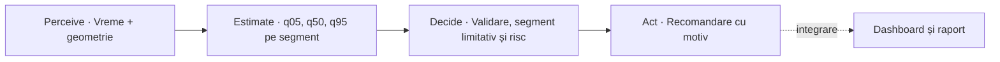

# GridPilot AI

**Dynamic Line Rating pentru o linie simulată cu trei segmente în Dobrogea.** GridPilot folosește vremea de-a lungul liniei pentru a estima curentul maxim admis la fiecare oră, identifică segmentul cu limita cea mai mică și generează o recomandare pentru operator.

Prototip realizat pentru **24h to Power PPC – AI in energy, from data to action**. Beneficiarul operațional vizat este Rețele Electrice. Un producător precum PPC Renewables ar putea valorifica energia suplimentară dacă limita termică a liniei este constrângerea care îi reduce livrarea.

> **Starea livrării.** Pipeline-ul meteo, modelul salvat și agentul rulează împreună în demo-ul offline. Dashboardul Streamlit afișează prognoza și recomandările live. Exportul automat de rapoarte rămâne o etapă de integrare.

## De la vreme la acțiune

O limită statică tratează linia la fel în fiecare oră. În realitate, vântul poate răci conductorul, iar temperatura ridicată și soarele îi reduc capacitatea de răcire. Dynamic Line Rating (DLR) estimează cât curent poate transporta conductorul în condițiile respective. Deoarece cele trei segmente sunt în serie, valoarea minimă limitează linia întreagă.



| Etapă | Comportament | Modul |
| --- | --- | --- |
| **Perceive** | Colectează seriile pe cele trei segmente, aliniază orele în UTC, verifică unitățile și marchează lipsurile. | [Pipeline meteo](src/data_pipeline.py) |
| **Estimate** | Modelul local estimează cuantilele de ampacitate pe segment. LineRate furnizează referința fizică pentru antrenare. | [Model ML](src/ml_model.py) · [Motor fizic](src/physics_engine.py) |
| **Decide** | Validează predicțiile, găsește minimul q05 la fiecare oră și clasifică riscul față de limita statică. | [Validare și monitorizare](src/multi_point_monitor.py) · [Motor de decizie](src/decision_engine.py) |
| **Act** | Produce o recomandare, motivul ei și un indicator de revizuire umană. Interfața și raportul sunt destinațiile prevăzute pentru aceste rezultate. | [Motor de decizie](src/decision_engine.py) |

## Echipa și punctele de integrare

| Rol | Responsabilitate | Predare către următorul rol |
| --- | --- | --- |
| **1 · Data Engineer** | Surse publice, configurația celor trei puncte, normalizare, verificarea datelor și demo fără API. | `weather.csv`, export NASA, prognoză și `weather_mock.csv` |
| **2 · ML Engineer** | Etichete de referință CIGRE, modele de comparație, regresie pe cuantile, calibrare și analiză pe test separat. | Modelul local, raportul de evaluare și `predictions.csv` |
| **3 · Agent Developer** | Validarea predicțiilor, identificarea segmentului limitativ, clasificarea riscului și recomandări. | Rezultatele orare de monitorizare și decizie. `agent_results.json` conține deciziile orare pe care le poate prelua interfața. |
| **4 · Frontend, Reports & Integration** | Dashboard Streamlit, integrarea datelor și deciziilor, raportare și pregătirea demo-ului. | Interfața și raportul pentru operator, plus reproducerea fluxului pentru juriu. |

## Pornire rapidă

Rulați din directorul `gridpilot-ai`. Mediul verificat folosește **Python 3.14**. Folosiți o instalare separată pentru dependențele proiectului, mai ales dacă aveți deja altă versiune de scikit-learn.

```bash
python -m pip install -r requirements.txt
python -m pip install "numpy==2.4.2" "pandas==3.0.1" "scikit-learn==1.9.1" "joblib==1.6.0"
```

Versiunile NumPy, pandas și scikit-learn corespund metadatelor modelului salvat. Pentru inferență se folosește artefactul din repository. Instalați LineRate separat când generați etichete fizice sau rulați testele fizice.

### Demo offline

După instalarea dependențelor, demo-ul rulează fără acces la internet. Fișierul meteo conține 24 de ore sintetice pentru fiecare segment. Modelul generează 72 de predicții, iar monitorul le grupează în 24 de evaluări ale liniei.

```bash
python -m src.ml_model predict --weather data/demo/weather_mock.csv --out data/processed/predictions_demo.csv
```

Rulați agentul din același director pentru a genera deciziile orare.

```bash
python -m src.agent --predictions data/processed/predictions_demo.csv --output data/processed/agent_results_demo.json
```

La 00:00 UTC, demo-ul identifică `SEG_3` ca segment limitativ, cu un q05 de aproximativ 1.162 A și acțiunea `RECOMMEND_DYNAMIC_RATING`. Dacă lipsește predicția unui segment, agentul marchează ora ca `UNCERTAIN`, recomandă `FALLBACK_STATIC` și cere revizuire umană. Vezi [testul de fallback](tests/test_validation_fallback.py).

## Date și contracte

Geometria din [line_segments.json](config/line_segments.json) este ilustrativă. Azimutul se măsoară în grade în sens orar de la nord.

| Segment | Latitudine | Longitudine | Azimut |
| --- | ---: | ---: | ---: |
| SEG_1 | 44,38 | 28,14 | 72° |
| SEG_2 | 44,46 | 28,48 | 71° |
| SEG_3 | 44,55 | 28,81 | 69° |

| Sursă | Rol în proiect | Fișier |
| --- | --- | --- |
| [Open-Meteo Historical Weather API / ERA5](https://open-meteo.com/en/docs/historical-weather-api) | Reanaliză orară 2022–2025, datele meteo folosite pentru modelul salvat. | `data/processed/weather.csv` |
| [NASA POWER Hourly API](https://power.larc.nasa.gov/docs/services/api/temporal/hourly/) | Sursă alternativă pentru istoric. Câmpuri `T2M`, `WS10M`, `WD10M` și `ALLSKY_SFC_SW_DWN`. | `data/processed/weather_nasa.csv`, generat la cerere |
| [Open-Meteo Forecast API](https://open-meteo.com/en/docs) | Prognoză live. Include umiditatea relativă în procesarea internă. | `data/processed/weather_forecast.csv`, generat la cerere |
| Date sintetice | Demonstrație offline, etichetată `SYNTHETIC_DEMO`. | [weather_mock.csv](data/demo/weather_mock.csv) |

Exportul istoric implicit este ERA5. Opțiunea `--dataset-output` generează, în modul ERA5, un set separat pentru predicția vremii la +1 h. Vechiul `data/processed/dataset.csv` aparține acelui flux. Modelul de ampacitate pornește de la contractul meteo.

```bash
# Reproduceți exportul ERA5 implicit pentru 2022–2025.
python -m src.data_pipeline
# Istoric alternativ NASA, verificat pe șapte zile.
python -m src.data_pipeline --historical-source nasa --start 2025-07-15 --end 2025-07-21
# Prognoză în UTC pentru următoarele 24 de ore.
python -m src.data_pipeline --forecast-hours 24
python -m src.ml_model predict --weather data/processed/weather_forecast.csv --out data/processed/predictions_forecast.csv
```

**CSV meteo.** Cheia este perechea `timestamp_utc` + `segment_id`. Contractul are exact opt coloane, în ordinea de mai jos.

```text
timestamp_utc,segment_id,air_temp_c,wind_speed_ms,wind_direction_deg,solar_radiation,source,data_quality
```

Temperatura este la 2 m, vântul la 10 m, în m/s și grade din direcția de proveniență, iar radiația este GHI medie orară în W/m². Parserul NASA verifică UTC și unitățile, transformă valoarea de umplere în lipsă și folosește echivalența numerică dintre Wh/m² pe o oră și media orară în W/m². Orele absente rămân în grilă și sunt marcate `missing`. Pipeline-ul calculează intern și unghiul acut față de axa segmentului și componenta perpendiculară a vântului.

**CSV predicții.** Modelul produce aceeași cheie orară, `q05_ampacity_a`, `q50_ampacity_a`, `q95_ampacity_a`, `static_rating_a`, `uncertainty_ratio` și `data_quality`. Ampacitățile sunt în amperi. Raportul de incertitudine este `(q95 − q05) / q50`.

## Modelul fizic și evaluarea ML

Motorul fizic folosește `linerate.Cigre601` pentru ampacitatea în regim staționar. La temperatura maximă admisă, încălzirea prin efect Joule și radiație solară este echilibrată de răcirea prin convecție și radiație. Configurația folosește un conductor de exemplu din LineRate și o temperatură maximă de 75 °C. Detaliile sunt în [configurația conductorului](config/conductor_config.json) și în [documentația LineRate](https://statnett.github.io/linerate/).

Modelul folosește vremea, geometria, componentele vântului și caracteristici temporale și solare. Regresorii `HistGradientBoostingRegressor` estimează q05, q50 și q95. Limita inferioară q05 primește o corecție calibrată pe validare. Împărțirea este cronologică după timestamp, aproximativ 70/15/15, cu un interval de separare de 24 de ore. Raportul include și un backtest cu ferestre succesive.

| Model | MAE pe test | RMSE pe test |
| --- | ---: | ---: |
| Baseline constant, mediană | 150,30 A | 191,80 A |
| Regresie liniară | 42,03 A | 59,36 A |
| HGB pe cuantile, calibrat | **4,45 A** | **6,79 A** |

Testul separat are **15.708 rânduri**. q05 calibrat a fost sub sau la nivelul referinței fizice în **96,05%** din cazuri, iar supraestimarea maximă a fost **60,28 A**. În grupul cu vânt slab și temperatură de cel puțin 30 °C, MAE a crescut la **21,32 A**, pe doar 35 de exemple. Acesta este un caz relevant de urmărit în demo și într-un pilot. [Raportul de evaluare](models/evaluation_report.md)

Cuantilele descriu eroarea de aproximare a referinței fizice. Un pilot trebuie să valideze separat eroarea prognozei meteo, parametrii conductorului și relația cu măsurători din teren. Rezultatele de mai sus provin din raportul modelului versionat.

```bash
# Reantrenare, cu etichete generate de modelul fizic.
python -m pip install "linerate==5.0.0"
python -m src.ml_model train --weather data/processed/weather.csv --segments config/line_segments.json
```

Comanda de antrenare regenerează modelul și rapoartele. Opțiunile `--model-out`, `--dataset-out` și `--report-dir` permit scrierea rezultatelor într-un director separat pentru comparație.

## Decizii și cazuri de date incomplete

Agentul calculează raportul `R = limita statică / limita dinamică q05`. Limita dinamică a liniei este minimul q05 al celor trei segmente pentru aceeași oră. Raportul compară două limite de curent, fără telemetrie de sarcină reală.

| Condiție | Risc | Acțiune recomandată |
| --- | --- | --- |
| `R ≤ 0,80` | LOW | `RECOMMEND_DYNAMIC_RATING` |
| `0,80 < R ≤ 0,95` | MEDIUM | `KEEP_STATIC` |
| `R > 0,95` | HIGH | `OPERATOR_REVIEW` |
| Date incomplete, invalide sau învechite | UNCERTAIN | `FALLBACK_STATIC` |

Validatorul verifică timestampurile, duplicatele, calitatea datelor, ordinea cuantilelor și valorile pozitive și finite. Monitorul verifică prezența segmentelor așteptate. O oră incompletă produce o recomandare de revenire la limita statică și cere revizuire umană. Regulile de incertitudine și de sarcină planificată pot avea prioritate față de pragurile din tabel. Pragurile sunt ipoteze pentru prototip, iar recomandările critice cer revizuire umană. Explicația deciziei se poate urmări din **oră → segment limitativ → q05 → prag → acțiune**.

## Dashboard și raportare

Porniți dashboardul din directorul `gridpilot-ai`, într-un mediu Python 3.11 compatibil cu modelul curent.

```bash
python -m pip install "scikit-learn==1.6.1" "numpy==2.4.6" "pandas==2.2.3" streamlit
python -m streamlit run app.py
```

Dashboardul preia prognoza pentru următoarele 24 de ore la prima deschidere și o actualizează aproximativ la 15 minute cât timp există o sesiune activă. După închiderea ultimei sesiuni, nu mai pornește actualizări. Dacă o rulare eșuează, afișează un avertisment și păstrează ultimul rezultat disponibil.

În fluxul țintă, operatorul selectează sursa meteo sau un scenariu offline și vede profilul orar al limitei statice și dinamice, intervalul q05–q95 pentru segmente, segmentul limitativ și acțiunea recomandată. Raportul preia ora UTC, sursa, calitatea intrărilor, limitele în amperi, motivul și indicatorul de revizuire umană. JSON-ul generat de demo oferă un exemplu de contract pe care se poate integra interfața.

## Impact economic și sustenabilitate

O limită mai mare creează valoare dacă producția disponibilă depășește limita statică, iar restul rețelei și condițiile comerciale permit livrarea. Operatorul poate evalua câtă capacitate existentă ar folosi mai bine. Producătorul poate estima venitul brut al energiei suplimentare livrate. Pe o linie trifazată echilibrată, conversia ilustrativă este `MW = √3 × kV × A × cos φ / 1.000`.

1. Pentru fiecare interval, calculați puterea livrabilă ca minimul dintre producția disponibilă și limita de export, separat pentru scenariile static și dinamic.
2. Înmulțiți diferența de putere cu durata în ore și păstrați și diferențele negative. Rezultatul este diferența de energie în MWh.
3. Aplicați prețul efectiv de decontare fiecărui interval. Scădeți costurile relevante pentru a estima beneficiul net.

Exemplu ilustrativ: 5 MW suplimentari timp de o oră la un preț ipotetic de 100 EUR/MWh înseamnă **5 MWh suplimentari și 500 EUR venit brut**. Un calcul real cere producția disponibilă, restricțiile rețelei, prețurile pe interval și costurile de implementare și operare. Impactul potențial este reducerea limitării energiei regenerabile. Proiectul folosește vreme publică, geometrie simulată și date sintetice, fără date personale sau telemetrie PPC.

## Verificări

```bash
python -m pip install pytest "linerate==5.0.0"
python -m pytest -q
```

Suita verifică parsarea meteo, calculul vântului transversal, contractul predicțiilor, comportamentul modelului, identificarea segmentului limitativ, pragurile și cazurile de fallback. În versiunea verificată, **81 de teste au trecut**.

## Structura proiectului

```text
gridpilot-ai/
├── config/                 Geometria segmentelor și parametrii conductorului
├── data/
│   ├── demo/               Vreme sintetică și configurație pentru demo
│   └── processed/          Date meteo, predicții și rezultate generate
├── models/                 Modelul salvat și rapoartele de evaluare
├── src/
│   ├── data_pipeline.py    Colectare și prelucrare meteo
│   ├── physics_engine.py   Referința fizică LineRate
│   ├── ml_model.py         Antrenare și inferență locală
│   ├── multi_point_monitor.py  Validarea predicțiilor și monitorizarea segmentelor
│   ├── decision_engine.py
│   ├── agent.py            Orchestrare și exportul deciziilor JSON
│   └── report_generator.py Punct rezervat pentru raportare
├── tests/
└── app.py                  Dashboard și actualizare pe durata sesiunii
```
