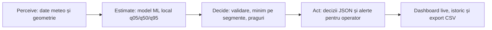

# GridPilot AI

**Agent de suport decizional pentru capacitatea dinamică a unei linii electrice aeriene simulate în Dobrogea.**

Proiect pentru **24h to Power PPC – AI in energy, from data to action**. Domeniul vizat este operarea rețelei, relevant pentru **Rețele Electrice**, cu beneficii potențiale pentru producători precum **PPC Renewables** atunci când transportul energiei este limitat de capacitatea termică a conductorului.

GridPilot colectează vremea, rulează un model ML antrenat de echipă, identifică segmentul restrictiv și publică recomandări și alerte pentru operator. Include dashboard, prognoză actualizată automat, istoric și exporturi CSV/JSON.

> **Prototip de simulare, nu sistem de comandă a rețelei.** Nu utilizăm telemetrie PPC, nu avem conexiune SCADA și nu comandăm centrale sau întreruptoare. Capacitatea estimată în amperi nu reprezintă curent măsurat. P1–P3 de pe hartă sunt amplasamente ilustrative; injecțiile lor de putere nu sunt modelate.

## 1. Problema și soluția

O limită statică se bazează pe condiții meteo de referință. Răcirea conductorului variază însă cu vântul, temperatura și radiația solară. GridPilot estimează capacitatea pentru fiecare oră și arată când condițiile sugerează o capacitate suplimentară sau necesitatea verificării umane.

Linia este simplificată la trei segmente în serie. Limita întregii linii este minimul limitelor segmentelor pentru aceeași oră. Un câștig de capacitate nu înseamnă automat energie suplimentară livrată: aceasta necesită producție disponibilă și respectarea celorlalte constrângeri ale rețelei.



| Etapă | Implementare | Dovezi |
|---|---|---|
| Perceive | Date istorice/publice, prognoză, UTC, unități și calitate | [data_pipeline.py](src/data_pipeline.py) |
| Estimate | HGB antrenat local pe etichete fizice; trei cuantile de ampacitate | [ml_model.py](src/ml_model.py), [physics_engine.py](src/physics_engine.py) |
| Decide | Validare, segment limitativ, incertitudine și clasificarea riscului | [agent.py](src/agent.py), [decision_engine.py](src/decision_engine.py) |
| Act | Scriere automată a deciziilor; notificări și coadă de verificare umană | [live_pipeline.py](src/live_pipeline.py), [alert_service.py](src/alert_service.py), [Alerts](pages/alerts.py) |

Agentul este un flux determinist care folosește predicțiile ML; nu depinde de un LLM sau de un API extern de inferență. Acțiunile autonome sunt publicarea deciziilor, alertarea în aplicație și arhivarea. Aplicarea unei limite în exploatare rămâne responsabilitatea operatorului.

## 2. Instalare reproductibilă

Mediul verificat: **Python 3.11**, scikit-learn **1.6.1**, NumPy **2.4.6**, pandas **2.2.3**, joblib **1.6.0**, Streamlit **1.67.0**, LineRate **5.0.0**. Modelul implicit este `models/ampacity_model.joblib`; versiunea scikit-learn trebuie să corespundă artefactului.

În PowerShell, dintr-un director în care doriți să clonați proiectul:

```powershell
git clone https://github.com/Fandrei19/Smarthack.git
cd Smarthack/gridpilot-ai
py -3.11 -m venv .venv
.venv/Scripts/python.exe -m pip install --upgrade pip
.venv/Scripts/python.exe -m pip install "numpy==2.4.6" "pandas==2.2.3" "scikit-learn==1.6.1" "joblib==1.6.0" "streamlit==1.67.0" "linerate==5.0.0" pytest matplotlib
```

`requirements.txt` existent conține doar NumPy și pandas; **nu este suficient pentru aplicația completă**. Comanda de mai sus instalează și dependențele ML, UI, fizică și teste. Pe Linux/macOS folosiți `python3.11 -m venv .venv` și `.venv/bin/python` în locul executabilului Windows.

Toate comenzile următoare se execută din `gridpilot-ai`, cu mediul activat. În PowerShell puteți înlocui `python` cu `.venv/Scripts/python.exe` dacă activarea mediului este restricționată.

```powershell
.venv/Scripts/Activate.ps1
python -m streamlit run app.py
```

Aplicație: **http://localhost:8501**. Prima deschidere descarcă prognoza și rulează modelul și agentul. Este necesară conexiune la internet pentru API și fundalul hărții.

### Demo offline al modelului și agentului

```bash
python -B -m src.ml_model predict --weather data/demo/weather_mock.csv --out data/processed/predictions_demo.csv
python -B -m src.agent --predictions data/processed/predictions_demo.csv --output data/processed/agent_results_demo.json
```

Intrarea sintetică are 24 de ore × 3 segmente: **72 de predicții și 24 de decizii ale liniei**. Acest flux CLI rulează fără API după instalare. Dashboardul folosește fișierele live și nu trece automat pe demo; nu prezintă datele sintetice drept prognoză curentă.

### Actualizare live unică

```bash
python -B -m src.live_pipeline --once
```

Produce `weather_live.csv`, `predictions_live.csv` și `agent_results_live.json` în `data/processed/`. În dashboard, actualizarea are loc la prima deschidere și aproximativ la 15 minute cât există o sesiune activă; butonul **Refresh now** permite actualizare imediată. Nu se lansează un serviciu permanent din dashboard. Comanda CLI fără `--once` este un mod separat, care rulează continuu până este oprit.

## 3. Interfața pentru operator

- **Overview:** limita estimată, referința statică, segmentul restrictiv și recomandarea agentului.
- **Line Monitoring:** selecție de oră, capacitate pe segmente, vreme, intervale q05–q95 și export CSV.
- **Map:** trei locații ilustrative în Dobrogea; P1–P3 sunt marcaje de amplasament, SEG_1–SEG_3 sunt segmente de conductor. Nicio producție sau injecție SCADA nu este calculată.
- **Alerts:** motiv, oră, segment, prioritate și confirmarea că operatorul a văzut alerta. Există notificări în aplicație și export CSV.
- **Weather History:** alegerea fișierului, intervalului de date, segmentelor și variabilei meteo; grafice și descărcarea selecției.

Notificările sunt în aplicație, nu email/SMS/push în afara ei. Alertele sunt verificate la un minut cât sesiunea este activă. Confirmarea **Acknowledge** este păstrată în sesiunea browserului; nu rezolvă cauza și nu aprobă limita.

Istoricul separă explicit vremea istorică de prognozele salvate. Fiecare rulare live reușită este arhivată în `data/archive/<UTC run ID>/`, cu vreme, predicții, decizii și momentul preluării. Arhivele sunt locale, ignorate de Git și nu au încă o politică automată de retenție. Prognozele arhivate nu devin observații reale după trecerea timpului.

## 4. Date, surse și contracte

| Sursă | Utilizare | Proveniență |
|---|---|---|
| ERA5 prin Open-Meteo | Vreme istorică 2022–2025 pentru modelul curent | [Historical Weather API](https://open-meteo.com/en/docs/historical-weather-api) |
| NASA POWER | Export istoric alternativ; exemplu verificat 15–21 iulie 2025 | [Hourly API](https://power.larc.nasa.gov/docs/services/api/temporal/hourly/) |
| Open-Meteo Forecast | Prognoză pentru următoarele 24 de ore în fluxul live | [Forecast API](https://open-meteo.com/en/docs) |
| Date sintetice | Demo offline, etichetat în câmpul `source` | [weather_mock.csv](data/demo/weather_mock.csv) |
| LineRate / CIGRE601 | Etichete fizice calculate pentru antrenare | [Exemplu oficial](https://statnett.github.io/linerate/auto_examples/plot_cigre.html) |

Datele meteo sunt estimări meteorologice grilate și prognoze, nu senzori pe conductor. NASA utilizează `T2M`, `WS10M`, `WD10M`, `ALLSKY_SFC_SW_DWN`. Open-Meteo include și umiditate în procesarea internă. Exportul agreat păstrează exact opt coloane:

```text
timestamp_utc,segment_id,air_temp_c,wind_speed_ms,wind_direction_deg,solar_radiation,source,data_quality
```

Temperatură în °C, vânt în m/s, direcție de proveniență în grade, radiație în W/m², timp UTC. Parserul verifică unitățile NASA și valorile de umplere. Perechea timp–segment identifică o înregistrare. Valorile lipsă sunt marcate; nu introducem diferențe artificiale între locații dacă sursa livrează aceeași celulă meteo.

Componenta perpendiculară a vântului este derivată ca `viteza × abs(sin(direcție − azimut))`, cu unghiul convertit în radiani. Caracteristicile suplimentare sunt calculate intern și nu adaugă coloane contractului de opt câmpuri.

| Segment | Latitudine | Longitudine | Azimut |
|---|---:|---:|---:|
| SEG_1 | 44.38 | 28.14 | 72° |
| SEG_2 | 44.46 | 28.48 | 71° |
| SEG_3 | 44.55 | 28.81 | 69° |

Configurație: [line_segments.json](config/line_segments.json). Geometria, conductorul și referința statică sunt ipoteze de simulare, nu active PPC verificate. Condițiile de utilizare și atribuirea furnizorilor trebuie păstrate când datele sunt redistribuite; accesul public nu implică lipsa condițiilor de licențiere.

```bash
# Istoric ERA5: export implicit 2022–2025; poate necesita timp și acces API.
python -m src.data_pipeline
# Export NASA alternativ, fără endpoint istoric plătit.
python -m src.data_pipeline --historical-source nasa --start 2025-07-15 --end 2025-07-21 --weather-output data/processed/weather_nasa_week.csv
# Prognoză separată, 24 h.
python -m src.data_pipeline --forecast-hours 24 --weather-output data/processed/weather_forecast.csv
```

## 5. Model ML propriu și evaluare

**Ce învață:** aproximarea capacității termice calculate de `linerate.Cigre601` pentru vreme și geometrie date. Nu este un model care prognozează direct vremea și nu este antrenat pe avarii sau curenți măsurați.

- Model: `HistGradientBoostingRegressor`, predicții q05/q50/q95 și calibrarea limitei inferioare pe validare.
- Caracteristici: temperatură, vânt, componente perpendiculară/paralelă, radiație, orientare și caracteristici temporale/solare.
- Baseline-uri: mediană constantă și regresie liniară; raportul include și HGB punctual.
- Artefact implicit: [ampacity_model.joblib](models/ampacity_model.joblib), inferență locală.
- Fizică: conductor de exemplu CIGRE TB 601, temperatură maximă presupusă 75 °C; [parametri și ipoteze](config/conductor_config.json).

### Separarea datelor modelului livrat

Metadatele artefactului și raportul din **7 noiembrie 2026, 18:57 UTC** indică o împărțire cronologică aproximativ **50/25/25**, cu 24 h de separare. Nu folosim o împărțire aleatoare a rândurilor între aceleași ore/segmente.

| Set | Rânduri | Perioadă UTC |
|---|---:|---|
| Antrenare | 52.596 | 2022-01-01 00:00 → 2024-01-01 11:00 |
| Validare | 26.226 | 2024-01-02 12:00 → 2024-12-31 17:00 |
| Test separat | 26.226 | 2025-01-01 18:00 → 2025-12-31 23:00 |

### Rezultate raportate pe test

| Model | MAE (A) | RMSE (A) |
|---|---:|---:|
| Mediană constantă | 156.3 | 193.2 |
| Regresie liniară | 42.24 | 59.50 |
| HGB calibrat, livrat | **4.831** | **7.269** |

MAE/RMSE caracterizează predicția centrală; evaluarea q05 se raportează separat. Pentru modelul livrat, q05 este sub sau egal cu referința fizică în **97.06%** dintre exemple; există **772 supraestimări (2.944%)**, cu maximum **52.06 A**. Aceste rezultate nu reprezintă o garanție de siguranță pe rețeaua reală.

**Error analysis:** la vânt sub 1 m/s, MAE este 8.918 A. La temperatură ≥30 °C și vânt sub 1 m/s, MAE este **16.96 A**, iar acoperirea q05 scade la **85.71%**, pe numai **35 de exemple**. Raportul include analize pe zi/noapte, radiație, vânt transversal, bootstrap pe zile și patru ferestre de backtest.

Dovezi: [evaluation_report.md](models/evaluation_report.md) și [evaluation_report.json](models/evaluation_report.json). Unele note de dezvoltare din `MODEL_CARD.md`/`README_model.md` descriu stări anterioare; pentru artefactul livrat folosim metadatele modelului și raportul datat de mai sus.

**Limita incertitudinii:** cuantilele descriu aproximarea unei referințe fizice sintetice. Nu acoperă eroarea prognozei meteo, îmbătrânirea conductorului, săgeata, erorile geometriei sau toate incertitudinile din exploatare.

### Reantrenare fără suprascrierea modelului livrat

```bash
python -m src.ml_model train --weather data/processed/weather.csv --segments config/line_segments.json --model-out models/retrained/ampacity_model.joblib --dataset-out data/processed/retrained_ampacity.csv --report-dir models/retrained
```

Codul de antrenare este în repository. Reantrenarea cu valorile implicite din cod poate diferi de configurația ponderată/calibrată a artefactului livrat. Configurația exactă a acestuia este în `metadata.train_config`; nu promitem reproducerea identică a cifrelor printr-o comandă cu alte opțiuni implicite.

## 6. Agentul: praguri și constrângeri

Pentru o oră completă: `I_line = min(q05_SEG_1, q05_SEG_2, q05_SEG_3)`.
Raportul `R = I_static / I_line` compară două limite, nu reprezintă o măsurătoare SCADA a încărcării.

| Situație | Acțiune |
|---|---|
| Date invalide/incomplete sau incertitudine invalidă | `FALLBACK_STATIC`, verificare umană |
| Incertitudine `(q95−q05)/q50 > 0.10` | `FALLBACK_STATIC`, verificare umană |
| Incertitudine `> 0.05` și `≤ 0.10` | `KEEP_STATIC` |
| Cu verificările trecute, `R ≤ 0.80` | `RECOMMEND_DYNAMIC_RATING` |
| Cu verificările trecute, `0.80 < R ≤ 0.95` | `KEEP_STATIC` |
| Cu verificările trecute, `R > 0.95` | `OPERATOR_REVIEW` |

Pragurile sunt **euristici de prototip**, nu praguri aprobate de PPC sau impuse de standarde. Marja mai mare permite recomandarea; marja mică sau incertitudinea mare limitează automatizarea. Codul are și verificări pentru sarcină planificată atunci când aceasta este furnizată; demo-ul nu pretinde telemetrie reală.

JSON-ul include `timestamp_utc`, `line_rating_q05_a`, `bottleneck_segment`, `risk_level`, `action`, `requires_human_review`, `reason`. Explicația este trasabilă: **intrări → predicții → segment restrictiv → prag → acțiune**. Nu pretindem explicații SHAP implementate.

`FALLBACK_STATIC` este o recomandare a prototipului, nu dovada că limita statică este sigură în orice condiții extreme. Un operator trebuie să valideze limita de rezervă și celelalte constrângeri ale rețelei.

## 7. Robustness, responsabilitate și securitate

- Parsare API, validarea unităților/timpului, tratarea erorilor HTTP și timeouturilor.
- Verificarea valorilor lipsă, nenumerice, nefinite, duplicatelor și ordinii cuantilelor.
- Verificarea prezenței tuturor celor trei segmente înaintea deciziei.
- Fișierele live se înlocuiesc după generarea reușită a întregului flux; la eșec se păstrează rezultatul precedent și se afișează avertizare. Publicarea celor trei fișiere nu este o tranzacție de bază de date.
- Interfața semnalează preluări mai vechi de 30 de minute și exclude orele expirate din monitorizarea curentă.
- Alertele disting risc HIGH de incertitudine sau probleme de date; acestea din urmă nu sunt avarii confirmate.
- Date publice/sintetice, fără date personale de clienți și fără acreditări SCADA. Nu încărcați secrete în Git.
- Modelul joblib trebuie încărcat numai dintr-o sursă de încredere. Dashboardul nu include autentificare sau audit multiutilizator și este destinat demonstrației locale.

## 8. Impact economic și sustenabilitate

Modulul [investment_calculator.py](src/investment_calculator.py) estimează valoarea unui scenariu de capacitate suplimentară. Presupune intervale orare și preț constant, fără producție reală sau calcul complet de rețea: rezultatul este **potențial ilustrativ, nu venit realizat sau profit validat**. Nu este prezentat într-o pagină Reports, eliminată din navigația curentă.

Conversie ilustrativă trifazată: `P_MW = sqrt(3) × U_kV × I_A × cos(phi) / 1000`.
Pentru un calcul operațional ar trebui comparată puterea efectiv livrabilă în scenariul static/dinamic, limitată de producție și rețea; energia este suma diferențelor MW × durata în ore. Venitul brut folosește prețul fiecărui interval, iar beneficiul net scade costurile relevante.

Beneficiul de mediu potențial este reducerea limitării producției regenerabile și utilizarea mai eficientă a infrastructurii existente. Nu raportăm emisii CO₂ evitate sau MWh salvați măsurați fără datele necesare.

## 9. Teste și dovezi pentru jurizare

```bash
python -B -m pytest -q
```

Ultima rulare completă verificată înaintea acestei actualizări de documentație: **96 passed**, Python 3.11, cu LineRate instalat. Acoperă date, model, fizică, validare, agent, istoric și alerte. Au fost verificate separat paginile Streamlit, confirmarea alertelor și fluxul live de 72 de predicții / 24 de decizii. Numărul de teste poate evolua.

| Criteriu hackathon | Dovadă în proiect |
|---|---|
| Idea & Relevance · 25p | Problemă de capacitate termică și integrare regenerabile; secțiunile 1 și 8 |
| ML Quality · 25p | Antrenare locală, baseline-uri, test cronologic, metrici și error analysis; secțiunea 5 |
| The Agent · 25p | Flux automat date → ML → decizie → JSON/alerte; secțiunile 1 și 6 |
| Robustness · 10p | Date lipsă, timeouturi, stale data, fallback și teste; secțiunea 7 |
| Explainability · 10p | Predicții pe segmente, praguri, motiv și verificare umană |
| Demo & Repository · 5p | Comenzi de instalare/demo, artefact ML, teste și surse |

**Cerințe eliminatorii:** model antrenat de echipă cu cod și artefact local; test separat și baseline; inferență fără API extern de ML; acțiuni automate dincolo de chat; date publice/sintetice cu surse. Tabelul documentează dovezi, nu garantează punctajul juriului.

### Demo de 5 minute

1. **0:00–0:40:** problema și scenariul simulat din Dobrogea.
2. **0:40–1:30:** Overview și comparația static/dinamic; precizați că A este capacitate, nu curent măsurat.
3. **1:30–2:20:** schimbați ora, arătați segmentul restrictiv și vremea în Line Monitoring.
4. **2:20–3:10:** Alerts: motiv, verificare umană și confirmarea unei alerte; nu forțați apariția unei alerte reale dacă prognoza nu o produce.
5. **3:10–4:10:** raport ML, baseline, test separat și cazul dificil vânt slab + căldură.
6. **4:10–5:00:** Weather History, surse, limita simulării și impactul potențial.

Pentru Q&A: explicați de unde vin etichetele, de ce folosim minimul segmentelor, limitele q05, pragurile, diferența dintre prognoză și măsurătoare și de ce capacitatea suplimentară nu este automat profit.

## 10. Echipa și structura

| Rol | Responsabilitate |
|---|---|
| 1 · Data Engineer | API-uri, configurație, curățare, UTC/unități, contract CSV și mock |
| 2 · ML Engineer | Referință fizică, antrenare, baseline, calibrare și evaluare |
| 3 · Agent Developer | Validare, monitorizarea segmentelor, risc și decizii |
| 4 · Frontend & Integration | Dashboard, vizualizări, alerte, integrare și demo |

```text
gridpilot-ai/
  app.py                    Navigație și actualizare pe durata sesiunii
  config/                   Segmente și ipoteze conductor
  data/demo/                Intrări sintetice versionate
  data/raw/                 Răspunsuri API păstrate
  data/processed/           Istoric, predicții și decizii
  data/archive/             Arhive live locale, ignorate de Git
  models/                   Modelul local și rapoarte de evaluare
  pages/                    Overview, monitorizare, hartă, alerte, istoric
  src/                      Pipeline, fizică, ML, agent și servicii UI
  tests/                    Teste automate
```

**Următorul pas pentru un pilot:** măsurători reale, validarea parametrilor/limitării termice, incertitudine meteo, constrângeri de tensiune/stabilitate și echipamente, fluxuri de putere și integrare controlată cu operatorul. Acestea nu sunt implementate ca funcții de producție în demo.
